# adbx

[](https://github.com/vigliafg/adbx/actions/workflows/ci.yml)
[](docs/CHANGELOG.md)
[](pyproject.toml)
[](LICENSE)

Clone funzionale moderno di **Alpha Four versione 3** (Alpha Software, 1993):
un database relazionale senza programmazione, con regole di campo, set,
report, script e applicazioni.

adbx **non emula il DOS**. Replica il comportamento di Alpha Four dentro una
finestra moderna con una griglia di caratteri scalabile **80×25** — le stesse
25 righe e 80 colonne del modo testo DOS — font TrueType **DejaVu Sans Mono** e
motore **SQLite**, su Linux, Windows e macOS. I file `.DBF` restano
interoperabili.

Questa è la variante **adbx-legacy**: l'interfaccia a 80×25 dell'originale,
con il font scalabile e il resto del prodotto invariato. Vive in un worktree
git dedicato (`adbx-legacy`) accanto alla versione a 132×43, che resta la
linea principale: stessi test, stesso motore, layout diverso.

> **Stato:** release **1.0.0** — conformità alle 25 lezioni del Tutorial,
> 521 test verdi, nessun test saltato.

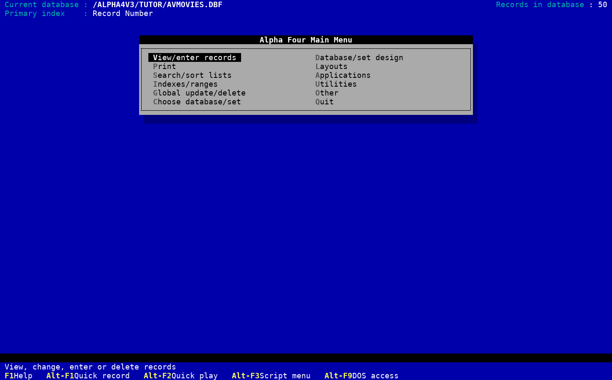

---

## Indice

- [Perché adbx](#perché-adbx)
- [adbx-legacy](#adbx-legacy)
- [Funzionalità](#funzionalità)
- [Requisiti](#requisiti)
- [Installazione](#installazione)
- [Avvio rapido](#avvio-rapido)
- [Interfaccia e tastiera](#interfaccia-e-tastiera)
- [Dati e workspace](#dati-e-workspace)
- [Script](#script)
- [Applicazioni](#applicazioni)
- [Configurazione e stampa](#configurazione-e-stampa)
- [Architettura](#architettura)
- [Struttura del repository](#struttura-del-repository)
- [Test e qualità](#test-e-qualità)
- [DOSBox automation e conferma visiva](#dosbox-automation-e-conferma-visiva)
- [Prestazioni](#prestazioni)
- [Screenshot](#screenshot)
- [Documentazione](#documentazione)
- [Compatibilità e deviazioni](#compatibilità-e-deviazioni)
- [Backup](#backup)
- [Sviluppo](#sviluppo)
- [Licenza](#licenza)

---

## Perché adbx

Alpha Four è una matrice di celle: report a larghezza fissa, regioni
scorrevoli, designer a placeholder, script che «digitano» tasti e verificano
il contenuto dello schermo.

Rendere questa interfaccia con widget moderni cambierebbe il prodotto.
Renderla con celle la conserva e rende report, script e designer molto più
semplici e fedeli. adbx segue questa idea fino in fondo:

- **griglia di celle** con carattere, colore, blink, bold e underline;
- **un solo gestore di tastiera**: anche gli script passano da lì;
- **semantica record-based** con cancellazione logica, `PACK`, ordine da
  indice primario;
- **SQLite** come motore, **`.DBF`** come formato di scambio;
- **determinismo**: ogni scelta con più esiti ammessi è fissata da un test.

## adbx-legacy

La variante **legacy** riporta l'interfaccia alle **80×25** celle
dell'originale: area di lavoro righe 1–22, status line 23, help line 24, menu
line 25. Non è un fork del motore: condivide codice, dati e test con la linea
principale a 132×43, e cambia solo la geometria della griglia e il reflow
delle schermate.

- **Worktree separato.** Vive in `../adbx-legacy`, sullo stesso repository git
  e sul ramo `adbx-legacy`; `adbx` resta intatto. Usa il proprio `.venv`
  (creato da `start.sh`), il proprio `config.json` e un workspace separato:
  nessun file dell'altra copia viene toccato.
- **Avvio.** Sempre dalla radice del worktree, perché i percorsi relativi
  (`config.json`, dati) seguono la cwd. `start-legacy.sh` entra da solo nella
  directory giusta e non richiede l'attivazione del venv:

  ```bash
  ../adbx-legacy/start-legacy.sh          # da qualunque directory
  cd ../adbx-legacy && ./start.sh         # equivalente
  ./start.sh --data ~/dati-legacy
  ./start.sh --smoke        # adbx 1.0.0: griglia 80x25, digest ...
  ```

- **Identità.** Il pacchetto resta `adbx` e la versione `1.0.0`; il titolo
  della finestra è `adbx — legacy (80×25)` e `adbx.VARIANT` vale `legacy`.
- **Dati.** Se `ADBX_DATA` è impostata, entrambe le copie usano la stessa
  cartella: per una prova affiancata passare `--data` esplicito. Non usare un
  comando `adbx` installato globalmente: potrebbe lanciare l'altra copia.
- **Differenze dichiarate.** I valori di stampa non cambiano (report fino a
  240 colonne, `page_length=22`, `print_width=80`, etichette 78×20): il canvas
  di stampa resta più largo dello schermo e il designer dei report lo dichiara
  nel titolo. I canvas 132 colonne salvati dalla versione larga vengono
  tagliati al bordo, con clipping dichiarato nei test.
- **Diario.** Le fasi, le verifiche visive e i limiti accettati sono in
  [`DIARIO-LEGACY.md`](DIARIO-LEGACY.md).

## Funzionalità

| Area | Cosa c'è |
|---|---|
| Database | fino a 128 campi, 4.000 caratteri per record, memo, password, table designer, riconfigurazione con conversione tipi |
| Record | View, Enter, Change, Browse, cancellazione/richiamo, memo editor, clipboard, Find, Locate, Replace |
| Indici | indici a più livelli, filtro, maiuscole, duplicati, primary index, 26 range, search/sort salvati e one-time |
| Field rules | default, incrementi, template, maschere, required, validation, double entry, skip, calcolati, summary, lookup table/database/cascading/conditional, post data, re-evaluate |
| Set | fino a 10 database, link `First`/`Last`/`Closest`/`All`, integrità referenziale, cascading update/delete, `Include Parent If`, regioni 1:N, zoom |
| Form | fino a 26 form, 25 schermate, campi, testi, riquadri, regioni, calcolati, summary, formattazione, form attivo |
| Report | 40–240 colonne, 9 livelli di gruppo, summary 7×3×4×2, multipass, widow/orphan, split lines, PDF |
| Etichette | fino a 26 layout, 10–78 colonne, 1–20 righe, 6 etichette per riga, giustificazioni avanzate, PDF |
| Lettere | editor con campi, espressioni, prompt, comandi di pagina, condizionali annidati, PDF |
| Utility | Copy, Append (4 modalità), Summarize, Pack, Zap, Crosstab, Post, Join, Intersect, Subtract |
| I/O | dBASE II, dBASE III/IV, ASCII separato, CSV, ASCII tabellare, DIF, SYLK, Lotus WKS/WK1, WordPerfect, MultiMate |
| Script | keystroke, dialog box, menu bar, registrazione, Screen Test, 40+ comandi, variabili, trigger, debugger |
| Applicazioni | outline, parametri, banner, macro, simulazione, Call-App/GotO-App, password, protezioni |
| Configurazione | `config.json`, default settings, date europee, 26 driver di stampa, colori per database, documentazione |
| Qualità | 521 test, 25 lezioni del Tutorial, CI 3.11–3.13, ruff, smoke, E2E visuale, benchmark, screenshot canonici |

### Anteprime

| Report | Form | Applicazione |
|---|---|---|
| 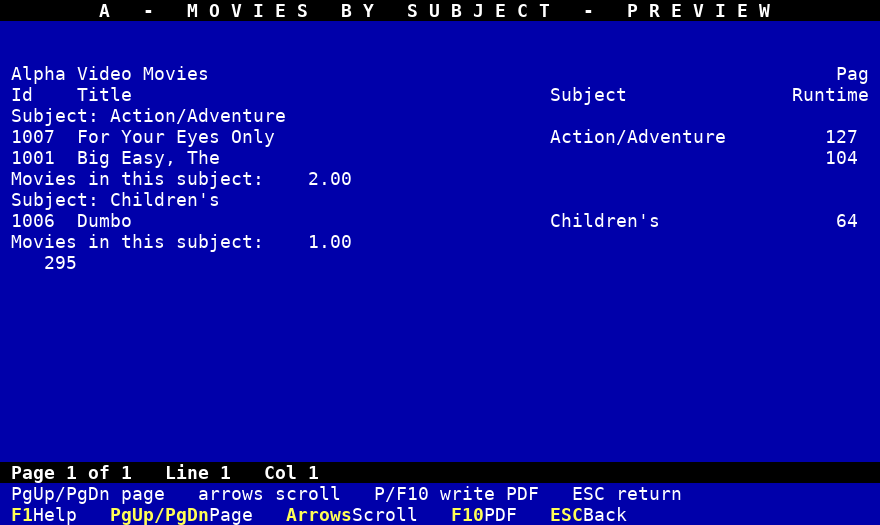 | 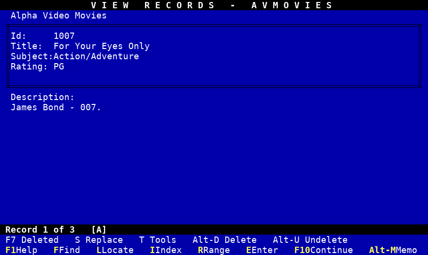 | 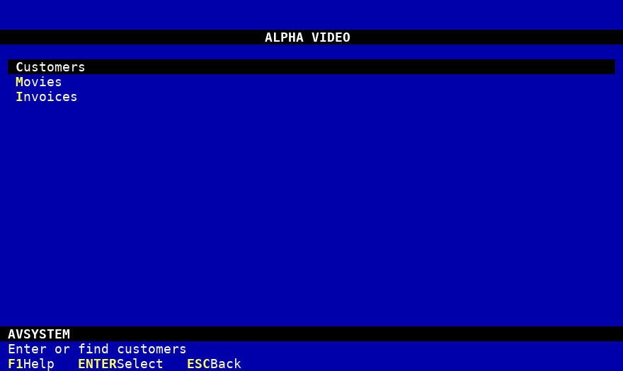 |

## Requisiti

- **Python 3.11+** (testato su 3.11–3.13; lo sviluppo locale usa 3.14).
- **PyQt6 ≥ 6.7**.
- Linux con le librerie Qt di sistema:

  ```bash
  sudo apt-get install -y libegl1 libgl1 libxkbcommon0 libfontconfig1
  ```

- Windows e macOS: nessuna libreria aggiuntiva oltre a PyQt6.
- Per i PDF non servono dipendenze esterne: il writer è incluso.
- DOSBox-X è opzionale e serve solo a confrontare l'originale.

## Installazione

### Avvio senza installazione manuale

```bash
git clone https://github.com/vigliafg/adbx.git
cd adbx
./start.sh
```

`start.sh` sceglie l'interprete, crea `.venv` alla prima esecuzione e installa
il pacchetto con le dipendenze. Non serve attivare l'ambiente a mano.

### Installazione classica

```bash
python -m venv .venv

# Linux / macOS
source .venv/bin/activate
# Windows (PowerShell)
.venv\Scripts\Activate.ps1

python -m pip install --upgrade pip
pip install -e ".[dev]"
```

Su Windows, senza `start.sh`:

```powershell
python -m adbx --data C:\dati
```

### Verifica

```bash
python -m adbx --version     # adbx 1.0.0
python -m adbx --smoke       # griglia 80x25 e digest
```

## Avvio rapido

```bash
./start.sh                              # banner, poi main menu
./start.sh --data ~/dati                # cartella dati, banner
./start.sh --open ~/dati/AVMOVIES.DBF   # apre un database
./start.sh --open ~/dati/ALPHAVID.SET   # apre un set
./start.sh --app AVSYSTEM               # avvia un'applicazione
./start.sh --smoke --dump               # dump completo della griglia
```

All'avvio compare il **banner** con l'ultimo database/set usato in basso:

1. `F10` (Continue) o una breve attesa caricano l'ultimo database/set e
   mostrano il **main menu**;
2. `F9` (Change Database/Set) apre il **Database Directory**;
3. scegliere un `.DBF` o `.SET` con le frecce e filtrare con `*` e `?`;
4. aprire con `ENTER` (si torna al main menu con il database corrente);
5. `Quit` chiude la sessione, `ALT-F10` torna al menu.

Senza un database precedente, `F10` porta al Database Directory.

## Interfaccia e tastiera

| Tasto | Funzione |
|---|---|
| `F1` | aiuto contestuale |
| `F2` | struttura del database |
| `F3` | status screen |
| `F10` | continua / salva |
| `ESC` / tasto destro | annulla un livello |
| `ALT-F10` | main menu |
| `ALT-F3` | menu Scripts |
| `ALT-F4` | suona uno script |
| `ALT-F1` / `ALT-F2` | registra / suona `UNTITLED` |
| `CTRL-F1…F10` | suona `CTRLF1…CTRLF10` |
| `CTRL-+` / `CTRL--` | zoom della finestra (50–200%) |
| `CTRL-0` | zoom al 100% |
| `F11` | full screen |
| `ALT-M` | memo editor |
| `ALT-D` / `ALT-U` | cancella / richiama record |
| `F` / `L` / `I` / `R` / `S` | Find / Locate / Index / Range / Replace |
| `T` | Tools in View/Browse |

I nomi dei comandi del main menu sono API della tastiera: la lettera
maiuscola è la hot key (`V`, `P`, `S`, `I`, `G`, `C`, `D`, `L`, `A`, `U`,
`O`, `Q`).

La griglia resta **80×25** a ogni dimensione della finestra: cambia il corpo
del font, non il layout. Le righe 23–25 sono status, help e menu line, come
nell'originale; l'area di lavoro sono le righe 1–22. Il corpo automatico si
ferma a **24 px logici** per lasciare margini leggibili sugli schermi grandi;
`CTRL-+` / `CTRL--` spostano lo zoom a passi del 10% (50–200%) e `CTRL-0` lo
riporta al 100%. Al 100% il testo occupa già tutto lo spazio utile; `CTRL-+`
ingrandisce allargando la finestra fino allo schermo, e `F11` porta la griglia
alla dimensione massima. Lo zoom non taglia mai la griglia: oltre il massimo
consentito dalla finestra il titolo mostra `(max)`. Il livello è salvato in
`config.json` (`screen_zoom`) e si può modificare anche da
`Other → Default settings`.

## Dati e workspace

Il workspace è una cartella dati. Il file nascosto `.adbx.sqlite` conserva:

- catalogo database, campi, password;
- record, memo, cancellazione logica;
- indici, range, search/sort;
- set, form, report, etichette, lettere;
- field rules, impostazioni, colori, protezioni.

Il `.DBF` resta la sorgente e il formato di scambio: viene importato al primo
accesso e riscritto a ogni salvataggio esplicito.

| Alpha Four | adbx |
|---|---|
| `.DBF` | tabella `t_<db>` + `__seq` + `__deleted` |
| `.DBT` memo | tabella `m_<db>(seq, field, body)` |
| numero record | posizione in ordine di `__seq` |
| `PACK` | delete fisico + rinumerazione |
| `.NDX` | tabella `i_<idx>(key, seq)` + definizione |
| `.SET` | tabella `sets` (JSON) |
| form, report, regole, script, app | JSON nel workspace o in `objects/` |

I numeri sono testo canonico (19 cifre, 14 decimali), le date `YYYYMMDD`, i
logici `0/1` con blank ammesso.

## Script

Tre tipi di script:

- **keystroke** — tasti e comandi, con registrazione e Screen Test;
- **dialog box** — Prompt, Button, Display;
- **menu bar** — menu alternativo per form e browse table.

Esempio:

```text
{SCREENOFF}
{WRITE 5,10,"Good morning... opening the databases"}
COAVMOVIES{ENTER}
COAVPATRON{ENTER}
COALPHAVID
{SCREENON}
{TONE 160,40}{TONE 250,80}{TONE 160,120}
```

Regole principali:

- i caratteri comuni sono tasti;
- `{COMANDO argomenti}` è un comando;
- `{*testo*}` è un commento;
- `:A` è una label;
- i blocchi si annidano, forma canonica `{{COMANDO ...}}`;
- `%NOME` è una variabile, `@%NOME` l'indirezione.

Comandi implementati: `ABORT`, `ALLOWKEYS`, `BEEP`, `CANCEL`, `CASE`, `CLEAR`,
`DEBUGOFF`, `DEBUGON`, `ENDAPP`, `EXEC`, `EXECCLR`, `GOTO`, `IF`, `LOOP`,
`MAINMENU`, `MOUSEDCLICK`, `MOUSEDOWN`, `MOUSEMOVE`, `MOUSEUP`, `NOCLEAR`,
`ONERROR`, `ONESCAPE`, `ONKEY`, `ONMAIN`, `PAUSE`, `PLAY`, `PROMPT`, `READ`,
`RPL`, `SCREENFREEZE`, `SCREENOFF`, `SCREENON`, `SET`, `SHOW`, `TONE`,
`TOOLEND`, `TRIGKEYS`, `VRESTORE`, `VSAVE`, `WAITFOR`, `WAITKEY`, `WAITSCRN`,
`WAITUNTIL`, `WRITE`, `XLOOKUP`, `XLOOKUPC`, `XLOOKUPR`.

I trigger si attivano con:

```text
{SET %SYS_TRIG_REC_SAVE,"SAVEWHAT"}
```

e si disattivano con `""`. Sono supportati i 22 eventi del manuale: record,
regioni, campi, lettere, search/sort, update, zoom.

Punti di aggancio:

- `AUTOEXEC` parte all'avvio;
- `<primi 7 caratteri>!` parte all'apertura di un database/set;
- `CTRL-F1…F10`;
- `Tools` in View/Browse;
- `PLAY` annidato fino a 10 livelli;
- debugger con `F10` (un token), `F5` (fino alla fine), `F3` (variabili).

## Applicazioni

Un'applicazione sostituisce il main menu con menu e sottomenu personali.

- **Sub-Menu** apre un altro menu;
- **Macro** esegue tasti e comandi;
- **Call-App** chiama un'altra applicazione e vi torna (max 10 livelli);
- **GotO-App** passa a un'altra applicazione senza tornare.

Ogni voce può avere help line, help file ASCII e password. Il `Menu flow`
dell'intestazione decide se, dopo un'azione, tornare (`Return`), restare
(`Stay`) o avanzare (`Advance`).

L'editor offre:

- outline indentato con intestazioni `=`;
- pannello parametri della voce;
- `F2` aggiunge, `F5` cancella;
- `F3` registra la macro, `F4` apre il Macro Editor;
- `F6` dipinge il banner;
- `F8` simula senza eseguire;
- `F10` salva.

`Prevent/allow file alterations` protegge Forms, Browse tables, Reports, Mail
labels, Letters, Ranges, Search/Sort lists e Field rules per database o set.

## Configurazione e stampa

`config.json` nella cartella di avvio è l'equivalente di `A4.DFL`:

```json
{
  "defaults": {
    "date_separator": "/",
    "date_format": "American",
    "pattern": "exact",
    "prevent_change": false,
    "prevent_enter": false
  },
  "printers": {
    "drivers": {},
    "default": ""
  }
}
```

`Other` contiene:

- **Pattern matching** — Exact, Case, Case-insensitive;
- **Default settings** — date, auto flush, prevent change/enter, single step,
  lock, dBASE IV, monocromatico;
- **Printer configuration** — 26 driver A–Z da 26 modelli, codici decimali,
  righe per pagina, avanzamento `Formfeed`/`Sheetfeeder`/`Linefeed`, margini,
  porta;
- **Set screen colors** — 18 token del tema per database o set;
- **Documentation** — struttura database/set, field rules, applicazioni,
  script, anteprima e PDF.

I PDF rispettano margini e font del driver attivo. Il flusso testuale applica
setup, close-out e avanzamento carta.

## Architettura

```text
config/   configurazione, stampanti, colori
cell/     buffer di celle, colori, CP437, renderer
screen/   scena, popup, dialog, menu, status, help, tastiera
data/     SQLite, DBF, record, indici, range, memo, regole, report
app/      applicazioni, menu, banner, runtime, protezioni
script/   modello, parser, variabili, motore, trigger, store
shell/    controller, sessioni, designer, schermate, configurazione
io/       import/export legacy e moderni
render/   Qt, PDF
docs/     specifiche, manuale, reference, render
```

### Flusso di un evento

```text
Qt key event
  → screen.keys.Key
  → ShellController.handle
  → sessione attiva (record, designer, report, script...)
  → View (griglia di celle)
  → CellRenderer (QPainter)
```

Il motore di script inietta i tasti nello stesso `ShellController.handle`:
non esiste un secondo percorso di input.

## Struttura del repository

```text
adbx/
├── src/adbx/
│   ├── app/          applicazioni
│   ├── cell/         celle e colori
│   ├── config/       defaults, printer, colors
│   ├── data/         SQLite, DBF, indici, regole, report engine
│   ├── docs/         generatore di documentazione
│   ├── io/           formati di import/export
│   ├── render/       renderer Qt e PDF
│   ├── screen/       tastiera e input Qt
│   ├── script/       motore di script
│   └── shell/        controller e schermate
├── tests/            521 test, 25 lezioni, performance, packaging
├── docs/
│   ├── spec/         specifiche tecniche
│   ├── reference/    inventario e manuali originali
│   ├── render/       62 screenshot canonici + riferimento DOSBox
│   ├── manuale-utente.md
│   └── CHANGELOG.md
├── tools/            capture, benchmark, release, DOSBox
├── PLAN.md           piano e architettura
├── DIARIO.md         diario delle ondate
├── DIARIO-LEGACY.md  diario della variante 80×25
└── start.sh
```

## Test e qualità

```bash
python -m pytest                 # suite completa
python -m pytest tests/test_tutorial_25.py
uvx ruff check src tests tools
python -m adbx --smoke
QT_QPA_PLATFORM=offscreen python tools/capture_ui.py --out /tmp/render
python tools/benchmark.py --records 5000
tools/build_release.sh
```

La suite include:

- **25 test**, uno per lezione del Tutorial;
- test del motore di script, di ogni comando e dei trigger;
- test di andata e ritorno per dieci formati di import/export;
- test di performance con soglie larghe;
- test di packaging e documentazione;
- un hook che **rifiuta i test saltati** (`skip`/`skipif`).

CI GitHub Actions su Python **3.11, 3.12 e 3.13**: lint, test, smoke,
rendering canonico, E2E visuale e benchmark.

## DOSBox automation e conferma visiva

`tools/dosbox_automation.py` pilota **Alpha Four 3.0 originale** in
[dosbox-automation](https://github.com/dosbox-automation/dosbox-automation)
tramite la REST API: monta il drive, avvia `A4.EXE`, legge lo schermo come
testo, digita tasti, attende un testo e cattura frame PNG.

```bash
# il binario è GPL-2.0 e non è versionato; --download lo mette in cache
python tools/dosbox_automation.py --download --screenshot /tmp/alpha4.png
python tools/dosbox_automation.py --probe
python tools/dosbox_automation.py --keys down,enter --text
```

Senza display usa `xvfb-run`; il token API è generato a ogni sessione e il
drive viene estratto dallo zip originale nella cache utente.

`tools/e2e_visual.py` esegue otto scenari end-to-end su adbx — menu, View,
Browse, editor di script, dialog box, applicazione, anteprima report e
documentazione — verifica il testo atteso e salva i PNG con hash e statistiche
in [`docs/e2e/`](docs/e2e/). Con `--dosbox` cattura anche il menu e la View
records dell'originale, per il confronto visivo.

```bash
python tools/e2e_visual.py
python tools/e2e_visual.py --dosbox   # richiede dosbox-automation
```

La conferma visiva è versionata: [`docs/e2e/README.md`](docs/e2e/README.md)
mostra affiancate le schermate adbx e DOSBox.

## Prestazioni

Benchmark riproducibile su 5.000 record (macchina di sviluppo, SQLite locale):

```bash
python tools/benchmark.py --records 5000
```

Il test di performance verifica 3.000 record per append, indice, ordered scan,
search, report e update con soglie pensate per la CI, non per il desktop.

## Screenshot

Tutte le schermate canoniche sono in [`docs/render/`](docs/render/); vengono
rigenerate da `tools/capture_ui.py`.

| | | |
|---|---|---|
|  | 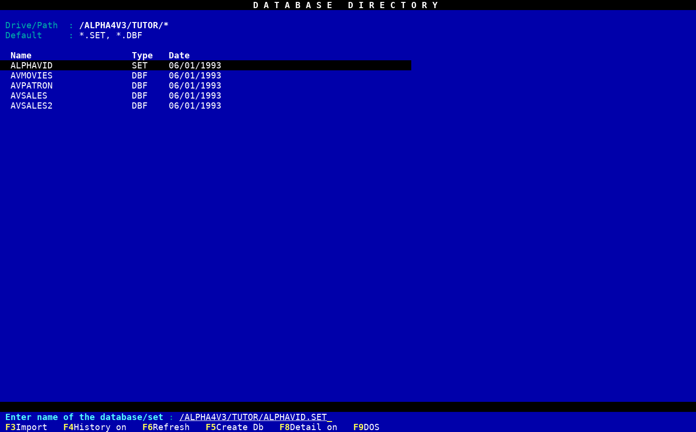 | 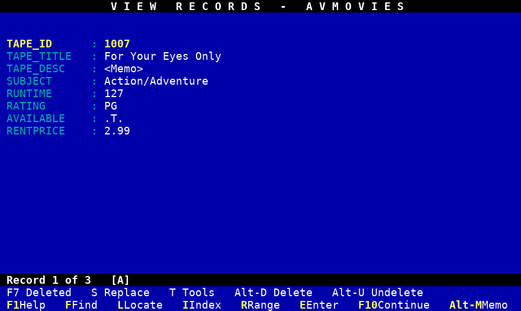 |
| 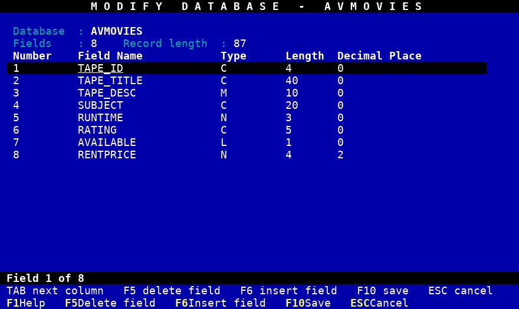 | 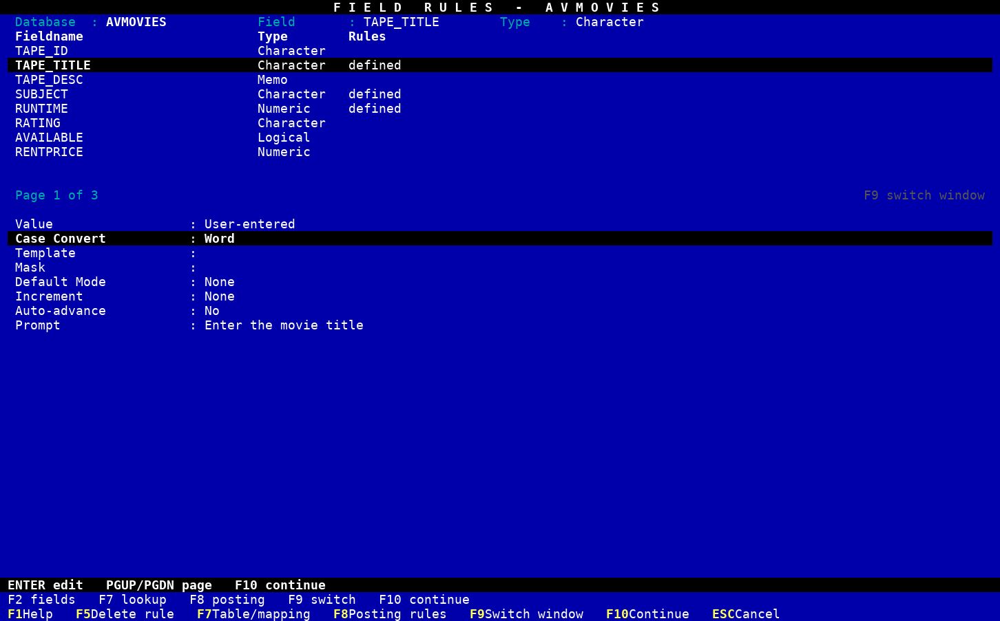 | 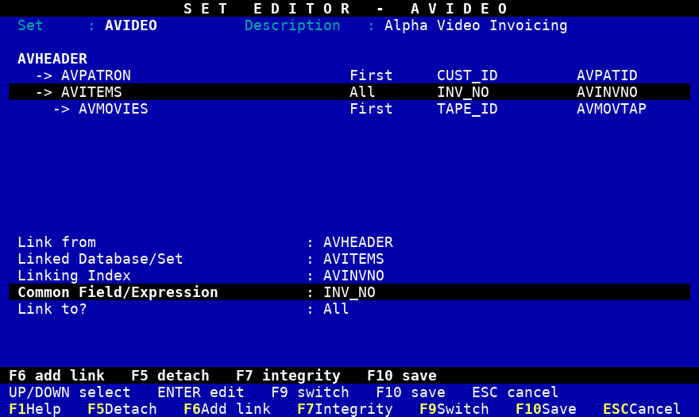 |
| 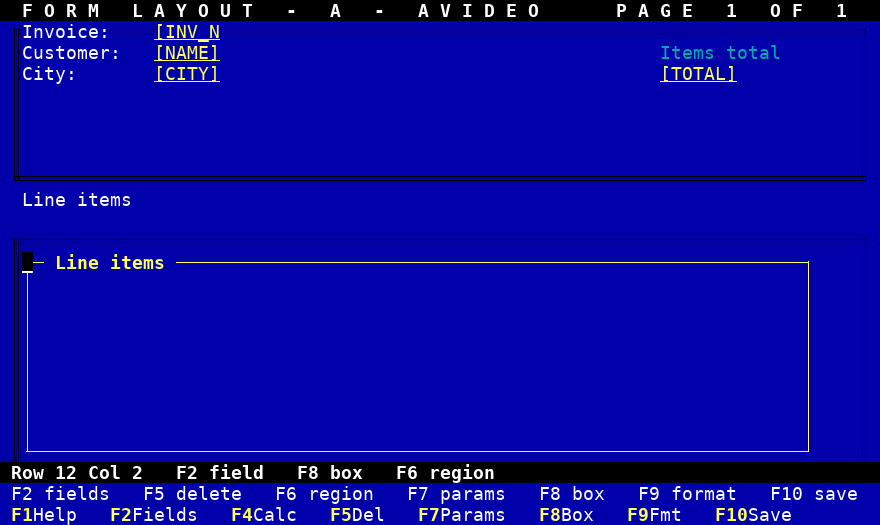 |  | 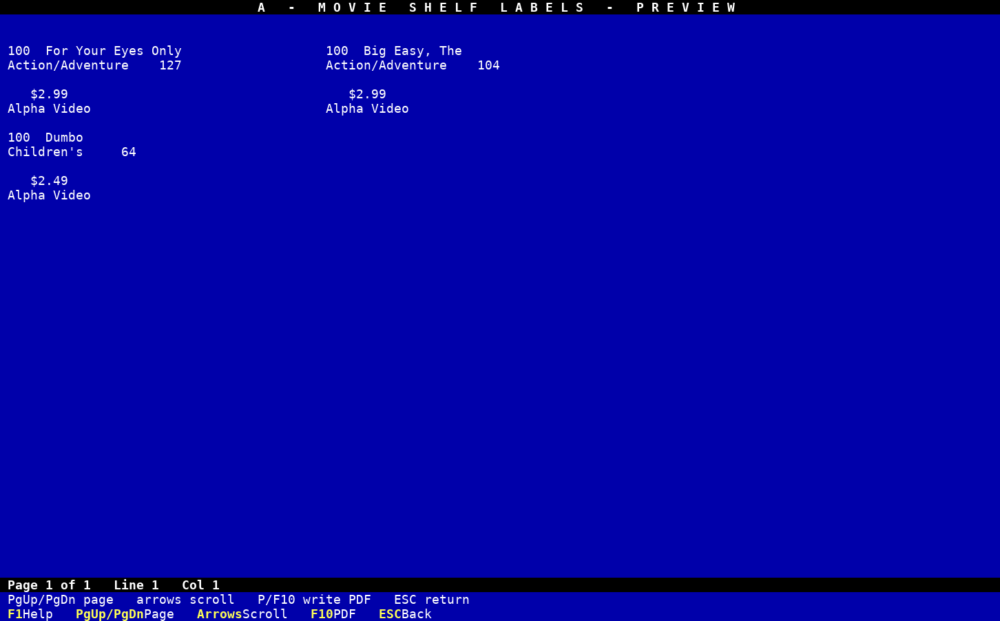 |
| 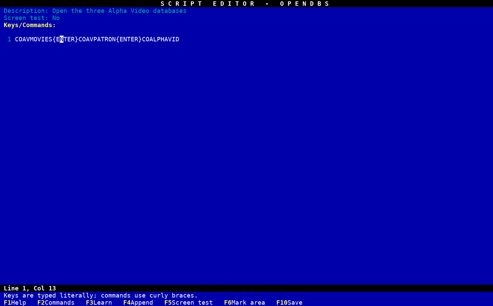 | 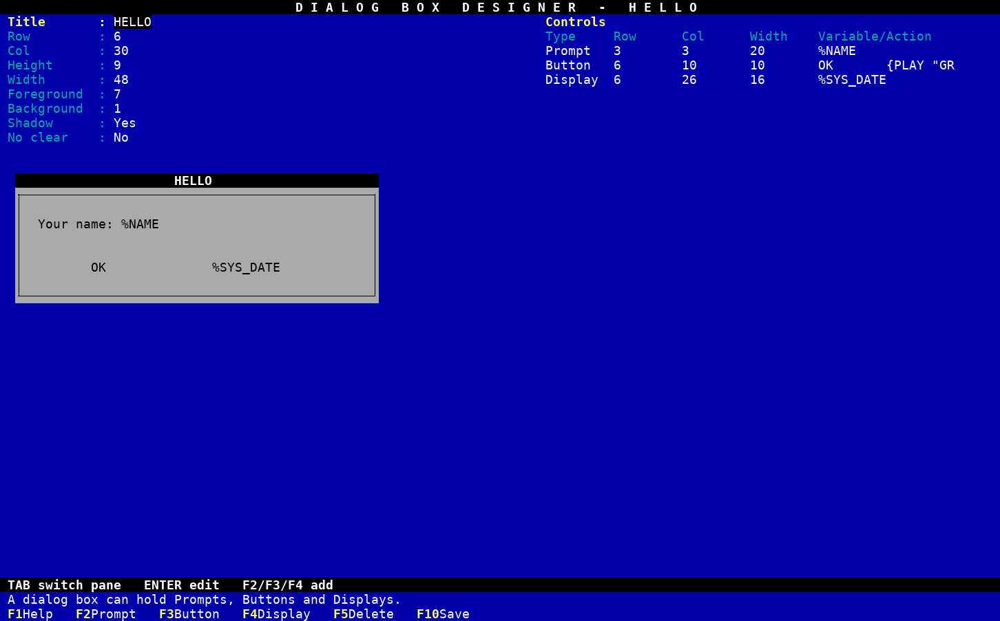 | 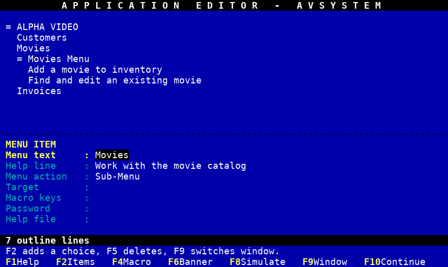 |
| 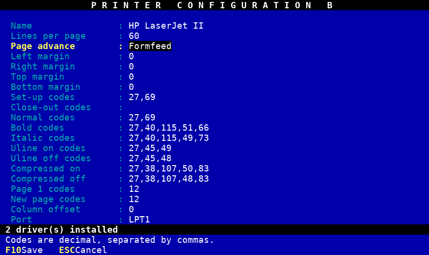 | 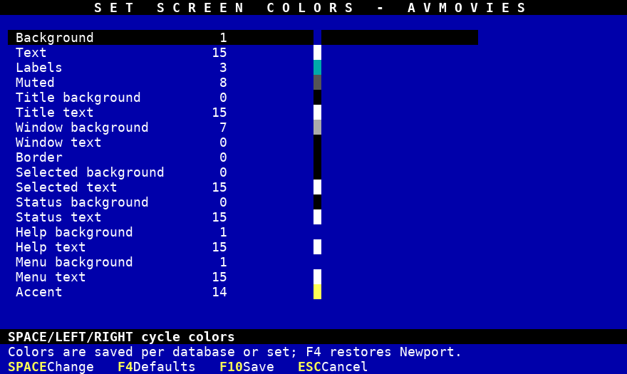 | 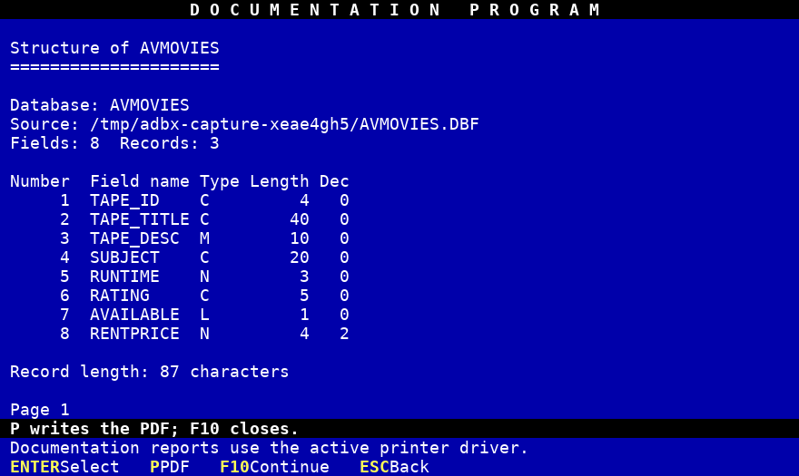 |

## Documentazione

- [Manuale utente](docs/manuale-utente.md)
- [Changelog](docs/CHANGELOG.md)
- [Piano e architettura](PLAN.md)
- [Diario di implementazione](DIARIO.md)
- [Inventario funzionale](docs/reference/00-inventario.md)
- Specifiche tecniche:
  [motore a celle](docs/spec/00-motore-celle.md),
  [scalabilità](docs/spec/01-scalabilita.md),
  [shell](docs/spec/02-shell.md),
  [ambiente DOS](docs/spec/03-ambiente-dos-riferimento.md),
  [dati e immissione](docs/spec/04-dati-immissione.md),
  [ricerca e indici](docs/spec/05-ricerca-indici.md),
  [regole di campo](docs/spec/06-regole-campo.md),
  [set](docs/spec/07-set.md),
  [form](docs/spec/08-form.md),
  [report](docs/spec/09-report.md),
  [etichette e lettere](docs/spec/10-etichette-lettere.md),
  [utility e I/O](docs/spec/11-utility-io.md),
  [script](docs/spec/12-script.md),
  [applicazioni](docs/spec/13-applications.md),
  [configurazione e stampa](docs/spec/14-config-stampa.md).

## Compatibilità e deviazioni

adbx è una reimplementazione indipendente, non un emulatore DOS.

Esclusioni dichiarate:

- runtime cifrato, `A4ENC`, `A4EXEMKR`;
- installer DOS, `SETUP.DTA`;
- multiuser, `A4.NET`, locking DOS;
- Novell, NetBIOS, Banyan, Lantastic;
- dialer Hayes e `MODEM.CFG`;
- swap EMS/XMS e parametri `CONFIG.SYS`;
- `.NDX` in scrittura (solo lettura);
- `A4LIB`, `SCRIPTED`;
- `PFS:File`, DBMII, Multiplan.

Deviazioni consapevoli:

- form fino a 25 schermate (il manuale stampato ne dichiara 10);
- colori di campo 0–255 mappati su 16 colori DOS;
- support files in JSON/SQLite, non file proprietari;
- numeri in testo canonico, non `REAL`;
- script in JSON leggibile, non `.SCP` binario;
- `EXEC`, `EXECCLR` e `RPL` non eseguono programmi DOS;
- attese degli script cooperative, senza bloccare l'event loop Qt;
- i driver di stampa alimentano PDF e stream testuali, non porte LPT/COM;
- niente stampa diretta: PDF e file sono i canali di uscita;
- MultiMate come documento testuale, non codifica binaria originale.

Dettagli completi in [`PLAN.md`](PLAN.md) §2 e nel manuale utente §13.

## Backup

1. Chiudere adbx.
2. Copiare l'intera cartella dati, inclusi `.DBF`, `.DBT` e `.adbx.sqlite`.
3. Conservare anche `config.json` e le cartelle `objects/`.

Copiare solo il `.DBF` non conserva regole, form, report, script e
applicazioni: quelle definizioni vivono nel workspace.

## Sviluppo

```bash
git clone https://github.com/vigliafg/adbx.git
cd adbx
python -m venv .venv && source .venv/bin/activate
pip install -e ".[dev]"

uvx ruff check src tests tools
python -m pytest
python tools/capture_ui.py --out /tmp/render
python tools/benchmark.py --records 1000
```

Il progetto segue il piano a ondate in [`PLAN.md`](PLAN.md). Ogni modifica
deve mantenere:

- test verdi e nessuno skip;
- ruff pulito;
- smoke e version verdi;
- documentazione e specifica aggiornate;
- screenshot canonici rigenerati quando cambia la UI.

L'originale DOS si può avviare per confronto:

```bash
sudo apt-get install dosbox-x
tools/run_alpha4_dosbox.sh            # TTF, corpo 58 (2320×1450)
```

Il runner parte di default in **output TTF** con `ptsize=58`: caratteri
vettoriali definiti e finestra 2320×1450 misurata su schermo 4096×2160.
`F12-Up` / `F12-Down` cambiano al volo il corpo del font. Alternative:
`--ttf=NN` (dimensione finestra in percentuale), `--ttf-size=NN` (corpo in
punti), `--no-ttf` (output bitmap/OpenGL).

Verificato con DOSBox-X 2026.01.02, `svga_s3`, 16 MB. I file del programma
originale non sono inclusi nel repository.

## Licenza

Codice e documentazione prodotta sono distribuiti con licenza **MIT**
([`LICENSE`](LICENSE)).

I PDF in `docs/reference/manuals/` sono manuali Alpha Software depositati
**solo per consultazione** e non sono coperti dalla licenza MIT. I file del
programma originale non sono inclusi.

Alpha Four è un marchio di Alpha Software Corporation. Questo progetto è una
reimplementazione indipendente, non affiliata né autorizzata; non contiene
codice o binari originali.
