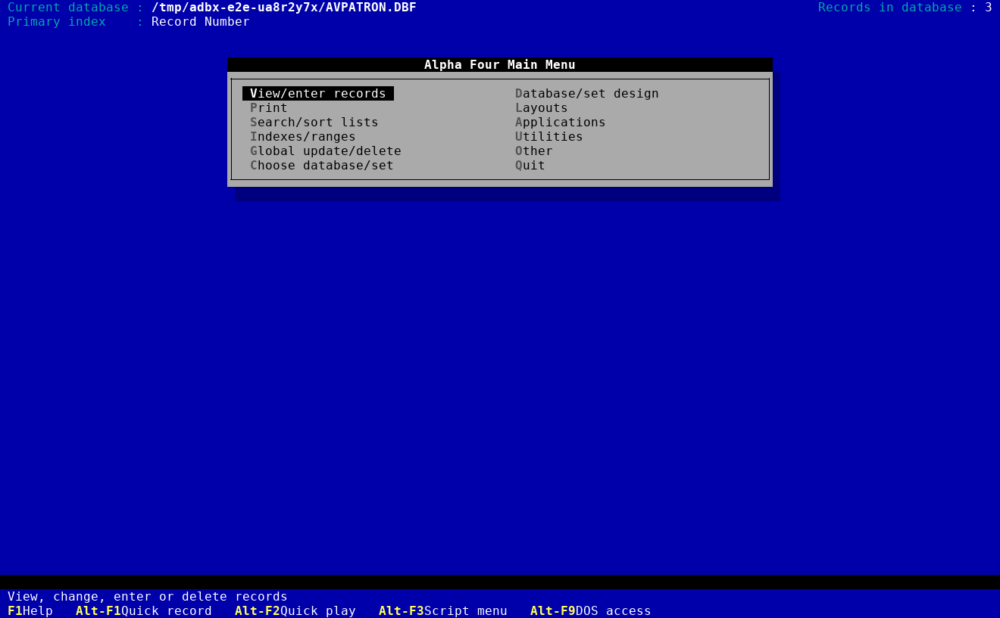
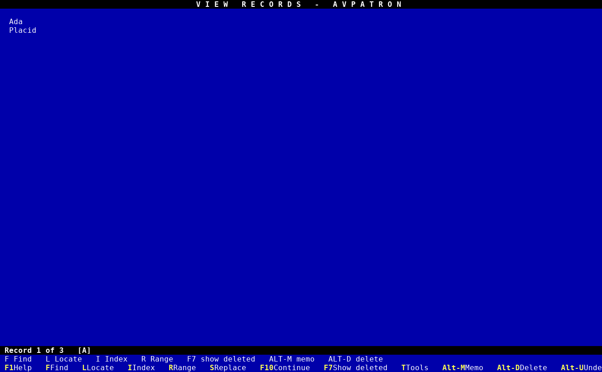
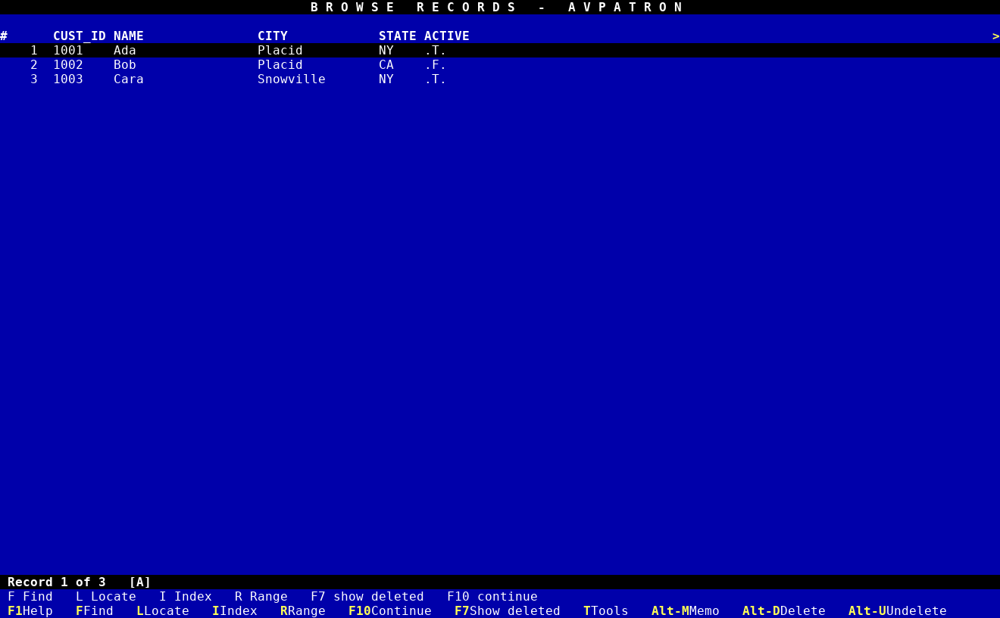
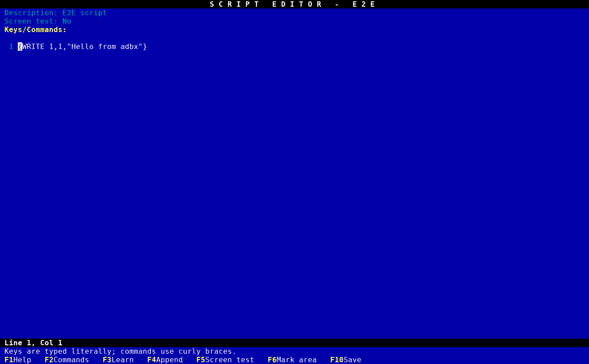
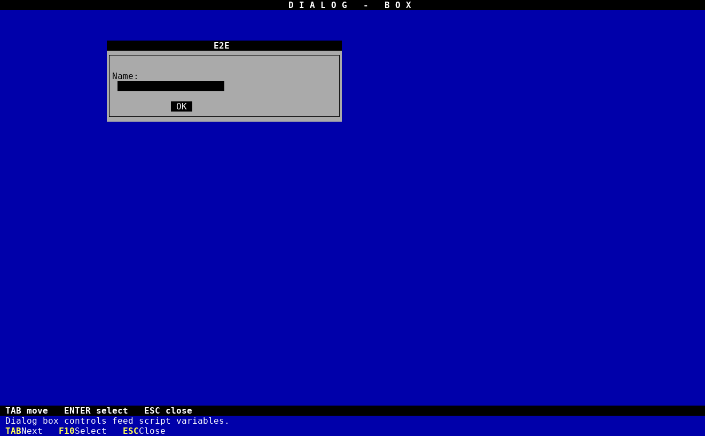
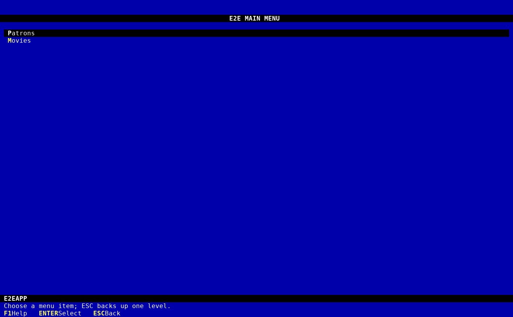
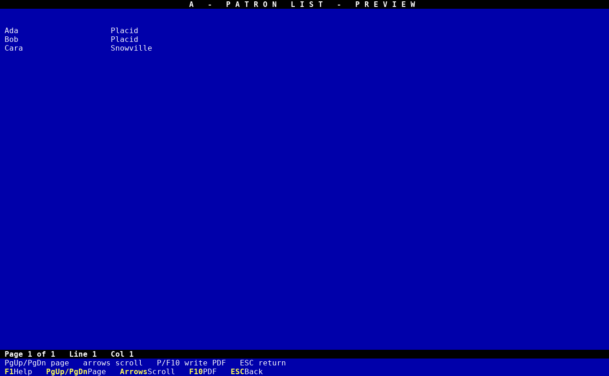
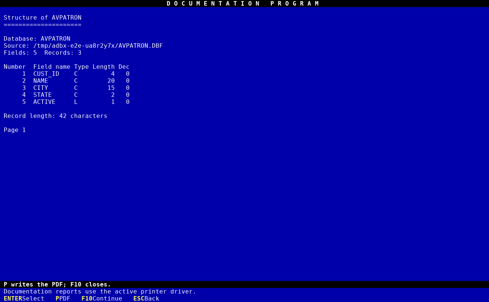
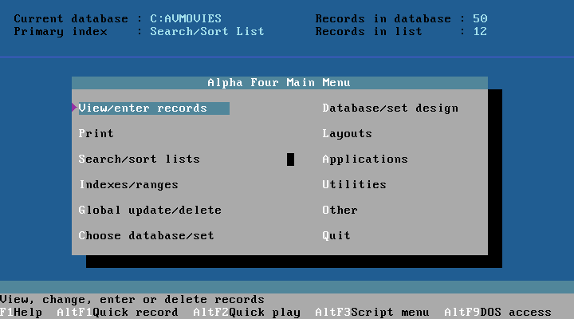
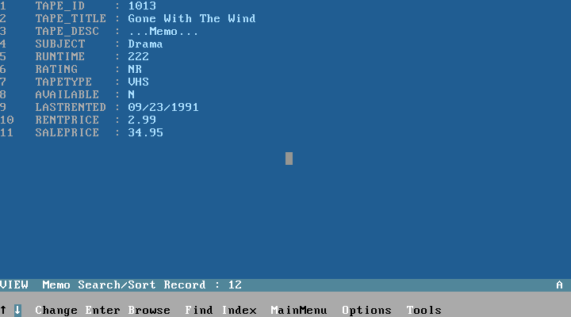

# Conferma visiva end-to-end

Immagini generate da `tools/e2e_visual.py`. Ogni scenario guida il
controller reale, verifica il testo atteso e salva il PNG.

```bash
python tools/e2e_visual.py
python tools/e2e_visual.py --dosbox   # richiede dosbox-automation
```

- `adbx/` — rendering della griglia 132×43 tramite il renderer Qt;
- `dosbox/` — Alpha Four 3.0 originale in dosbox-automation,
  catturato via REST API (`/api/v1/video/frame`);
- `manifest.json` — testo atteso, dimensioni, colori e SHA-256.

| Scenario | Atteso | Immagine | Dimensioni |
|---|---|---|---|
| 01-adbx-main-menu | `Alpha Four Main Menu` |  | 1320x817 |
| 02-adbx-view-records | `Ada` |  | 1320x817 |
| 03-adbx-browse | `CUST_ID` |  | 1320x817 |
| 04-adbx-script-editor | `Description:` |  | 1320x817 |
| 05-adbx-dialog | `Name:` |  | 1320x817 |
| 06-adbx-application | `E2E MAIN MENU` |  | 1320x817 |
| 07-adbx-report-preview | `Ada` |  | 1320x817 |
| 08-adbx-documentation | `Structure of AVPATRON` |  | 1320x817 |
| 01-alpha4-main-menu | `Alpha Four Main Menu` |  | 720x400 |
| 02-alpha4-view-records | `TAPE_ID` |  | 720x400 |
